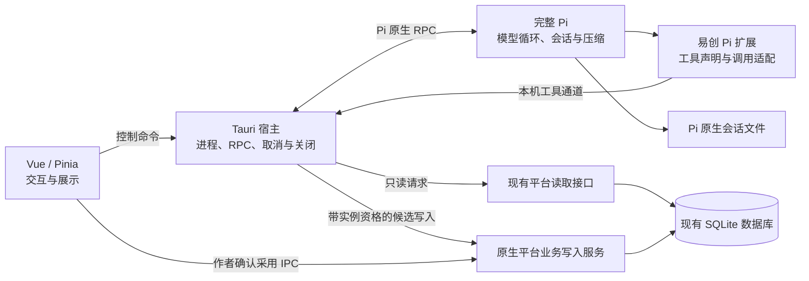

# Agent Pi G2 架构评审

日期：2026-10-21。依据[开发计划](agent-pi-development-plan.md)及[G1 评估](agent-pi-gap-assessment.md)。本文件确定职责与关键机制；接口字段、错误枚举、兼容数据结构及逐项开发任务留给 G3/G4。

**评审结论：保留完整 Pi 和原生 RPC；宿主负责进程与操作资格，平台负责数据规则和事务。模型候选写入经过可撤销的原生提交边界；作者确认后的正式采用在现有 SQLite 中一次提交。正常对话维持进程，主动停止后关闭该实例，下次由 Pi 恢复同一会话。**

这是待实施的架构决定，本轮没有修改业务代码或验证新方案已在产品中生效。

后续已进入按批实现，当前进展见 [开发说明](../agent-pi/README.md)。本文保留 G2 的设计依据，不能据此认定所有机制已完成。

## 1. 已确认的产品边界

延续 R1–R11：独立 Pi 板块；已有作品读资料、写新章/改稿、候选预览编辑和确认保存；切页继续；保留旧 Agent、妙笔和续写；暂不发布。新章默认追加作者指定的已有卷末尾，归属不明确先询问，采用前展示目标。

本轮用户进一步确认：

| 决策 | 确定行为 |
| --- | --- |
| D4 停止与正式保存 | 停止生成和工具操作；已由作者确认的正式保存独立完成，失败时整体回滚。结果无法确定时先查询，不把超时直接当失败。 |
| D5 停止后的 Pi 进程 | 正常对话保持进程；主动停止后结束当前 Pi 进程，下次发送恢复同一会话。历史和草稿保留，不自动重发刚才的任务；重新启动开销尚未测量。 |

D1 仍有效：运行中关窗先提示确认，停止并完成必要保存后关闭。D4 意味着关窗需要等待已经确认的保存有明确结果，而不是用终止 Pi 代替保存收尾。

## 2. 分层职责

宿主和原生业务服务都运行于 Tauri 进程，但职责分开。原生业务服务是范围有限的数据入口，不是另一套 Agent 底座。

| 层 | 拥有的职责与事实 | 不承担的职责 |
| --- | --- | --- |
| 完整 Pi | 模型循环、工具选择、重试、压缩、原生会话历史、消息事件、运行空闲与取消语义 | 平台正式保存授权、书库事务、作者确认状态 |
| 易创 Pi 扩展 | 模型配置适配、工具 Schema、写作 Skill、原生工具 signal 与平台请求的连接 | 自建循环、自动连载、重新生成“已确认”的正文 |
| Tauri 宿主 | 实例身份与生命周期、RPC 请求/回执关联、通信错误、操作取消资格、关闭协调和原生事件转发 | 决定写哪章、章节版本规则、正文/目录 SQL 和写作质量判断 |
| 平台业务层 | 作品/卷/章归属校验、读取基线、候选修订、正式采用授权入口、原子写入、防重复、回执及存储维护互斥 | 推断模型是否完成、恢复 Agent 执行步骤、模型调用 |
| Vue / Pinia | 输入、资料/目标选择、候选编辑、确认交互，显示 Pi 和平台返回的事实，切页后回读 | 自行判定运行结束、多次调用拼接正式保存、保存第二份权威会话历史 |

状态分别有明确来源：运行事实来自 Pi；进程存活和取消资格来自宿主；保存事实来自平台事务/回执。前端的连接中、提交中等交互状态可以存在，但不能替代这些事实。

## 3. 复用与必要新增的取舍

| 现成能力 | G2 决定 |
| --- | --- |
| Pi AgentSession、SessionManager、原生 RPC、工具 AbortSignal | 继续使用，不修改 Pi 核心。Pi 的 abort 会等待其自身空闲；跨进程的业务副作用仍由易创处理。 |
| 现有 Rust PiHost 和本机工具桥 | 保留并收敛职责。请求关联和超时处理归宿主，减少页面自行维护通用 RPC 状态；不为复用 Node RpcClient 再套一层 Node 宿主。 |
| 现有 Pinia、平台只读接口及展示风格 | 保留。复杂参考资料等读取继续复用；涉及保存依据的读取/验证由平台业务层给出可信基线，不能仅相信模型自报版本。只读适配需核实没有隐含修复写入。 |
| 现有 ew-writing.db、SQLx、BEGIN IMMEDIATE、WAL、desktop_records | 直接复用，候选和操作回执放在 Pi 专属记录命名空间。原则上不新增数据库，也不为本阶段预设新的物理表迁移。 |
| desktop_sql_transaction | 复用其单连接事务机制，不直接把前端任意 SQL 列表当作正式采用 API；当前 execute_statements 不检查条件更新是否命中。 |
| 旧 Agent 的 save_chapter_in | 不直接接入。它关联旧操作命名空间和记忆更新，也不能直接覆盖新章、候选修订和目录章名保护。复用底层事务/数据约定，不引入旧会话或审批链。 |
| Rust 会话列表解析 | 首阶段保留受限元数据读取，仅用于列表和作品绑定，按锁定格式校验及单文件容错；会话解释、恢复和压缩仍由 Pi 完成，不建第二份会话库。 |
| 新增原生平台写入入口 | 只补“候选写入/编辑、确认采用、查询采用结果”等本阶段所需能力；不全量重写 JS 书库和资料接口。 |

上游版本继续固定为 1.3.0 / 48c8f322844087ff6cd80885f093ad44557647d1。优先扩展和配置；若后续必须修改核心，先给出缺口、最小补丁与上游升级办法，不能将改动留在被忽略的缓存中。[Pi RPC](https://github.com/earendil-works/pi/blob/48c8f322844087ff6cd80885f093ad44557647d1/packages/coding-agent/docs/rpc.md)

## 4. 取消传播方案

### 4.1 使用现有实例身份，停止后不重新授权旧实例

正常对话可以在同一 Pi 进程连续执行。每个进程已有唯一 instanceId；对应的工具通道令牌、请求登记和取消上下文绑定到该实例。

停止后，这个实例的操作资格永久失效，不把同一个标记重新置为有效。下一次发送创建新实例，恢复原会话文件。旧 HTTP 请求、旧前端回调或旧数据库等待即使迟到，也只能携带旧上下文，不能附着到新实例。

这利用已确认的 D5，避免为保持被取消的进程常驻而另做一套每轮执行调度。实例资格和正在执行的 I/O 登记只承担资源控制，不持久化为第二套任务状态。

单个工具请求也有独立、不可重新启用的有效期：请求取消或超时后，其提交资格失效，即使 Pi 实例仍用于正常对话。扩展的单次取消需对应明确的请求身份，不能只断开 fetch。原生提交同时检查实例和请求资格；Pi 正常结束但平台操作尚未收尾时，界面分别显示该事实，不能假报全部完成，也不让新 prompt 越过未决操作。正常结束且操作已收尾时保持进程，不额外重启。

### 4.2 停止顺序

1. 前端请求停止当前 instanceId，宿主立即关闭其新请求入口，并将其已登记的模型工具操作标记取消。
2. 宿主向 Pi 发送原生 abort 和 clear_queue，分别关联结果。可以先写入清队列命令，但绝不等待它的响应成功才发送 abort；一个失败不能阻止另一个发出。
3. 扩展继续使用原生 AbortSignal 取消本机请求。平台取消不依赖 HTTP 断连：宿主持有的实例取消上下文才是本次停止的依据。
4. 平台中尚未进入提交临界区的模型写入回滚或拒绝；只读迟到结果丢弃。已经完成提交的候选保留并可查询。
5. 等待 Pi 的取消/空闲证据、模型工具写入收尾及该实例未决调用处理完成；随后关闭 stdin，按 Pi 原生关闭流程退出并回收进程。
6. 确认旧实例不能继续执行或提交后才显示“已停止”。保留 sessionFile、作品绑定、会话历史和平台候选；下次用户发送时恢复，不自动重放旧 prompt。

如果请求超时、退出失败或结果无法确定，显示停止未完成/通信异常并保留事实状态。当前固定两秒后杀进程的路径不能作为“已保存”的证明。异常退出也要撤销实例资格并收尾原生操作，不能仅清空界面 running。

### 4.3 模型写入的提交边界

仅在前端检查 signal 或在写入前检查一次布尔值，都存在检查后仍写入的竞态。因此，所有模型触发的候选持久化必须经过原生平台提交入口，包括现有大纲候选；前端回调不得继续直接 put 草稿绕过它。

- 开始时校验实例、请求身份、工具白名单和目标归属。
- 数据库锁等待不占用取消控制锁；取得数据库写事务后重新检查取消状态。
- 提交前经过该实例的短提交临界区：校验资格与提交顺序由同一同步机制保护，不能在“检查通过”和“决定提交”之间让停止绕过。
- 停止先关闭新请求入口；若某次提交已先进入临界区，等待它完成，按真实结果保留或回滚。其余操作拒绝提交。
- 停止完成回执发出后，不再允许该实例产生新的持久化结果。这里保证的是停止完成后的边界，不承诺用户点击按钮的瞬间所有 I/O 已结束。
- 临界区和数据库事务内不等待模型、WebView、HTTP 或作者输入。锁的次序在 G3 固定，并覆盖数据库忙、取消、关闭交错测试。

**作者正式采用不使用 Pi 实例的取消资格。**它由可信主窗口 IPC 发起，受平台保存和关闭/维护协调管理，按 D4 独立完成。模型工具通道没有正式采用入口，也不能通过 approved 字段冒充作者确认。

## 5. 正式保存一致性方案

### 5.1 权威数据与作者确认

Pi 保存会话；平台保存候选及采用回执；正式正文继续只有书库一份。候选不是第二份正式作品。

作者确认绑定一个已持久化的候选修订和目标快照。前端先保存编辑，再展示/确认该修订；提交时使用被确认的 draftId、revision 和内容/目标指纹，不读取可能已经切换的 openedDraft 全局对象。修订或目标变化后，旧确认不能用于新内容。

同一次采用使用稳定操作身份，由候选身份与被确认修订确定。界面重试、重新挂载和应用重启继续使用同一身份，不在每次点击时创建新的保存操作编号。同身份不同请求必须拒绝。

这些是接口约束，不要求新建一套审批引擎。字段名、指纹规范和旧草稿兼容方式由 G3 定义。

### 5.2 一个原生入口，一次 SQLite 事务

正式采用入口只接收类型明确的业务请求，宿主只做调用来源检查与分发。平台业务服务在同一连接开启 BEGIN IMMEDIATE，然后完成：

1. 先查同一操作的已提交回执：请求指纹一致就返回原结果，不再次写入；不一致则拒绝。
2. 读取被确认的候选修订，确认尚未被其他操作采用；检查作品、卷、目标章的存在、归属和删除状态。
3. 修改既有章时，对比正文版本、目录章名以及本次目标依赖的字段；冲突则整体拒绝，不覆盖人工修改。不要用整本书 updateTime 作为无关修改的冲突条件。
4. 在本事务内保存既有正文历史，更新正文、章名、目录统计和书籍统计；新章则在本事务内分配标识和卷末位置、插入章记录及正文。新章没有原文时不伪造一份修改前历史。
5. 更新候选采用状态，并写入稳定操作身份、请求指纹和返回结果。
6. 检查条件更新/插入实际命中数，任何必需步骤失败均回滚，最后只提交一次。

保护现有字段与约定：正文格式、localVersion、原文历史、dirty/remoteVersion、备份标记、字数口径、目录列与 JSON payload、负数本地标识及安全整数范围。不通过 OR REPLACE 覆盖已有新章；标识冲突需处理，不能覆盖另一章节。

新增章默认“目标已有卷的末尾”。保存前展示卷和追加语义；具体排序号由事务内最新目录确定。卷已删除、改属或作者明确目标失效时拒绝，不换到别的卷。若界面展示并要求确认具体章节位置/编号，G3 必须明确相应的目标版本检查。

SQLite 的单写者事务为这组写入提供共同提交边界；冲突校验与影响行数检查仍由业务代码完成。[SQLite 事务](https://www.sqlite.org/lang_transaction.html) · [连接间隔离](https://www.sqlite.org/isolation.html)

### 5.3 回执丢失、重试与恢复

| 情况 | 处理 |
| --- | --- |
| 校验失败或明确回滚 | 返回未保存，候选保留；历史、正文、目录与采用回执均不产生本次部分结果 |
| 提交成功，响应或界面通知丢失 | 按同一操作身份查询已提交回执；返回原版本/章编号，不重复建章或留历史 |
| 请求超时，原生操作还在执行 | 返回执行中或结果待确认；不能因为查询暂时没有回执就断言未保存 |
| 进程在提交前退出 | 数据库恢复完成后没有已提交操作；允许使用原身份重试，重新检查当前版本 |
| 进程在提交后退出 | 数据与回执一起存在；恢复返回原结果，禁止重新生成或再建章 |
| 提交返回异常且回读也失败 | 结果未知，保留候选及操作身份；不得换新编号再次写入或宣称已回滚 |

重试请求仍进入同一事务和去重路径，不能在事务外“先查没有回执，再无条件写入”。若原操作仍持有写锁，后来的同身份提交等待或返回忙，不与其并行产生第二个结果。

数据库提交是成功依据。编辑器刷新和目录通知在提交后发送，通知失败不能把已保存改报为未保存；页面重进通过平台回读收敛。首阶段不新增持久化事件总线，回执及回读足以承担恢复。

### 5.4 公共存储的并发约束

原子采用不能自动修复其他入口在事务外读取旧 payload 后再整行覆盖的问题。G3 必须核对目标章节的公共目录写入，以及新章标识/排序分配；必要时做最小的条件更新、字段级更新或统一原子分配适配，并列出精确影响范围。

这属于平台一致性前置条件，不能假定新事务上线后所有旧写入都安全，也不能据此重构整个编辑器或旧 Agent。若所需改动扩大到已确认范围之外，先提交具体影响与选择请用户确认。

## 6. 关闭、维护与界面恢复

- **切页：** Pi 正常运行；Pinia 保留会话，页面返回初始化候选编辑内容并回读宿主与平台状态。无须新建后台调度器。
- **主动停止：** 按第 4 节完成后关闭实例，下次由 Pi 恢复同一会话。平台模型配置失效时明确提示，不悄悄切换模型或作品。
- **关闭主窗口：** 用户确认后阻止新的 Pi 任务及新的采用请求；撤销模型工具操作，等待已确认保存完成，保存必要的作者编辑和 Pi 正常关闭能够落盘的历史，再执行既有备份/关闭流程。保存失败或结果未知时保留窗口并说明，不把终止子进程当作数据已保存。
- **全库恢复/迁移：** 新原生写入必须加入现有维护边界。不能只依赖前端 trackStorageWrite，因为原生候选写入可能不经过页面。维护开始后禁止新操作，并与当前 Pi/保存操作协调；沿用现有“活动任务先停止再恢复”的规则，不静默打断任务。
- **应用异常退出：** 通过 SQLite 事务恢复和操作回执确定正式保存结果；通过 Pi 原生文件恢复已有历史，不自动重放工具或 prompt，不承诺恢复尚未形成有效候选的任意半截工具参数。
- **已有大纲能力：** 保留。自动候选写入也受取消资格控制；大纲正式采用沿用已有业务规则，不硬塞进章节事务，也不宣称本轮完成了大纲全流程重新验收。

关闭协调与维护协调是原有流程的必要接入点；不改变旧 Agent、妙笔或续写的功能设计。

## 7. 不采用的方案

| 方案 | 不采用原因 |
| --- | --- |
| 继续由前端依次保存历史、正文、目录、回执 | 跨调用失败会留下部分结果，不能解决 G1 的保存缺陷 |
| 只取消 fetch 或只删除等待回执 | 平台操作可能已开始，不能阻止迟到写入 |
| 把所有保存都绑在 Pi AbortSignal 上 | 会中断作者已经确认的独立保存，违背 D4 |
| 停止后重新启用同一实例资格 | 旧回调可能被新的任务误接纳；D5 允许用已存在的进程隔离简化边界 |
| 完整移植旧 Agent 的保存/会话模块 | 带入旧状态、回执命名空间和记忆副作用，违背独立接入目标 |
| 新建消息队列、工作流引擎、独立作品数据库或全量 Rust 业务重写 | 本阶段现有 Pi 和 SQLite 能力足够，没有必要引入这些机制 |

## 8. 架构场景推演

以下是设计审查，不是已通过的运行测试：

| 场景 | 方案应产生的结果 |
| --- | --- |
| 停止发生在模型工具写入资格检查之前 | 拒绝候选写入 |
| 停止发生在数据库等待/准备中 | 取得资源后重新检查并回滚，不进入提交 |
| 提交已先进入临界区，随后停止 | 明确收尾该提交；停止完成后不会再新增该实例结果 |
| 新实例启动后收到旧请求或旧事件 | 旧实例资格已永久失效，不能进入新实例 |
| 停止时正式采用已被作者确认 | 正式保存独立完成；关闭时等待其明确结果 |
| 重复确认或提交成功后回执丢失 | 同身份得到同一结果，正文、历史和新章最多产生一次本次效果 |
| 目录章名、正文或删除状态在采用前改变 | 在同一事务内发现冲突并拒绝，不留下部分历史或新章 |
| 回读暂时无回执但原操作仍在执行 | 维持待确认，不能假定失败后发起不同身份的新保存 |
| 恢复数据与 Pi 写入同时发生 | 维护准入和在途操作协调阻止交错写入新旧数据 |

## 9. G3 必须落定的内容

G2 的分层、停止后关闭实例、模型取消与作者保存分离、原生平台事务四项决策已经确定。进入业务编码前，G3 还需给出：

1. 宿主 RPC、工具请求、实例撤销、错误/未知结果与取消完成的精确契约；请求 ID、实例 ID、操作 ID 各自用途及清理规则。
2. 原生提交临界区、SQLite 锁、关闭/维护锁的固定顺序与超时行为，避免持锁等待外部进程。
3. 新章与改稿候选结构、修订/指纹、稳定采用身份、读取依据及旧草稿兼容；不把旧已采用稿伪造成具有新事务回执的数据。
4. 平台写入字段及公共写入影响清单；对照现有正文格式、字数、备份和版本规则准备兼容用例。
5. 生命周期时序及对 G1 D01–D07 的覆盖；将故障注入、实际 SQLite、真实桌面验证拆开记录。

D3 测试平台、模型和预算仍在 G4 确认。若 G3 揭示需要修改 Pi 核心、扩大业务范围或改变已确认交互，再先询问用户。

## 10. 评审证据与当前状态

本轮核对了锁定 Pi 的 abort、clear_queue、工具 signal、进程退出及会话恢复源码；检查了平台事务、版本写入、旧 Agent 保存依赖、目录更新和维护流程。没有重复运行 G1 测试，也没有用设计推演冒充新架构验证。

业务基线见 [G2 基线](../verification/pi-architecture-20261021/run-t2iarmdk/baseline.json)：638 个文件与 G1 相同。G2 只更新文档；上述机制仍待 G3/G4 完成后实现与验证。

关键源码：

- [Pi 宿主](../src-tauri/src/pi_host.rs)：193–235 行为当前退出/取消实现，需按新边界调整。
- [平台事务](../src-tauri/src/desktop_storage.rs)：19–79 行为同库连接、WAL 和 BEGIN IMMEDIATE；624–658 行为通用 SQL 批量事务。
- [旧保存函数](../src-tauri/src/agent_store.rs)：202–290 行含正文、历史、回执及旧记忆副作用，不直接复用整个函数。
- [平台目录写入](../src/storage/sqlite-local-library.ts)：496–520、547–551 行是 G3 需要核对的并发适配点。
- [平台正文条件写入](../src/storage/sqlite-writing-storage.ts)：216–270 行；[数据恢复协调](../src/storage/full-backup.ts)：651–670 行。
